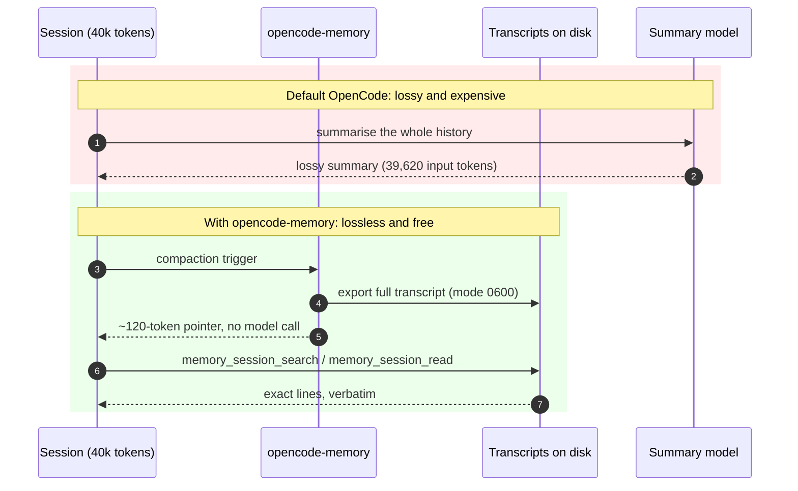
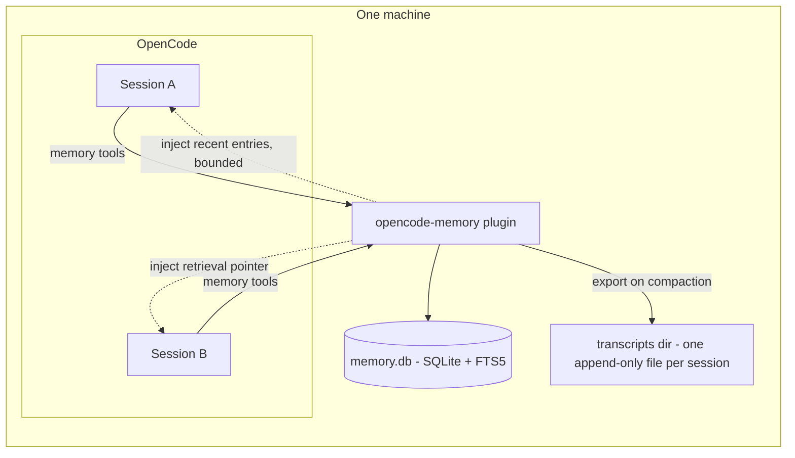

# opencode-memory

[](https://github.com/log0u7/opencode-memory/actions/workflows/ci.yml)
[](LICENSE)
[](https://www.typescriptlang.org)
[](https://www.npmjs.com/package/@log0u7/opencode-memory)
[](https://www.npmjs.com/package/@log0u7/opencode-memory)

Working memory for [OpenCode](https://opencode.ai): a shared SQLite store that all sessions on a machine read and write, so decisions, facts, and lessons survive session boundaries. And when compaction hits, the full transcript is exported and a ~120-token pointer replaces the lossy summary: exact recall, zero model tokens.

Every session gets six memory tools (`memory_save`, `memory_search`, `memory_list`, `memory_forget`, `memory_stats`, `memory_restore`) plus transcript search, reading and cleanup when context retrieval is enabled. Entries are scoped per project worktree (plus a `global` scope), searched with SQLite FTS5 (BM25 ranking, entries matching every query token first, then prefix matches fill the remaining slots). Recent entries are also injected into the prompt: once per session, and again during compaction. 100% local, no cloud, no API keys.

## Why

Two problems every long OpenCode session hits:

1. **Sessions forget.** A decision made on Monday ("use WAL mode") is gone by Wednesday's fresh session, and the agent never thinks to grep old notes.
2. **Compaction destroys context.** When the context window overflows, OpenCode asks a model to summarise the whole history in one call - measured on a live ~40k-token session: 39,620 input tokens, tens of seconds - and the result is lossy by construction: exact errors, paths and numbers get paraphrased away.

opencode-memory fixes both with one idea: keep the full record, let the agent retrieve what it needs.



## Highlights

- **Lossless compaction.** The summary model call is replaced by a pointer: the transcript path, the last user request, and the retrieval rule. Zero model tokens, nothing paraphrased away, no dependency on a prompt cache.
- **Memory that outlives sessions.** One SQLite store (WAL mode, FTS5 BM25 ranking) shared by every session on the machine, scoped per project worktree plus a `global` scope. Recent entries are injected into the prompt automatically.
- **The agent writes its own memory.** The system prompt nudges it to save durable decisions, facts, preferences and gotchas as they emerge; distilled lessons (`kind=lesson`) are injected first in later sessions, so known mistakes are not retried.
- **Exact recall from past sessions.** `memory_session_search` greps exported transcripts for exact lines with context; `memory_session_read` reads a numbered window; `/memory-continue <sessionID>` brings a past session back into the current one.
- **Optional LLM reflection.** On session idle, one bounded call distils at most `maxLessons` lessons from the transcript tail (~2k input tokens, ~$0.001 with a small model). Off by default.
- **Safe by default.** Secret-shaped strings are refused at write time; deletes go to a restorable trash; query deletes never cross scopes; tool results are size-capped; everything stays on the machine - no cloud, no API keys.

## Safety limits

- Results are capped: at most 50 entries per call, and each body is rendered as a 500-character preview. A tool result has a bounded size whatever the model asks for.
- `memory_save` rewrites an entry that repeats a scope and title instead of stacking duplicates, and purges expired rows.
- `memory_forget` by query only deletes inside the caller's scope (plus the shared `global` scope); by id it trashes the entry wherever it lives, since ids are globally unique. Either way it reports the titles and ids it removed, so a broad query delete is auditable.
- Entries that look like secrets (`sk-…`, `github_pat_…`, `gho_…`, `glpat-…`, `xoxb-…`, webhook URLs, …) are refused, in the title, kind, body and tags alike.

## Install

Register the plugin in `opencode.json` (project or global `~/.config/opencode/opencode.json`):

```json
{
  "plugin": ["@log0u7/opencode-memory"]
}
```

Restart OpenCode. That is it: the store lives at `~/.local/share/opencode-memory/memory.db` (honors `XDG_DATA_HOME`).

The package is installed automatically at startup into opencode's plugin cache (`~/.cache/opencode/packages/`); no global npm/pnpm/mise install is needed (opencode does not consult global installs for plugins). Pin a version if you want upgrades to be explicit:

```json
{
  "plugin": ["@log0u7/opencode-memory@0.8.1"]
}
```

Note (npm 12): the package ships no lifecycle install scripts and needs no `allowScripts` / allowlist on install.

## Usage

Nothing to do manually: the model is instructed to search memory at task start and save durable facts as they emerge. You can drive it explicitly:

```
memory_save(kind="decision", title="Use WAL mode", body="...", tags=["db"])
memory_search("postgres migration strategy")
memory_list()
memory_forget(id="...")
memory_stats()
```

### Tools

| Tool | Args | Description |
|---|---|---|
| `memory_save` | `kind`, `title`, `body`, `scope?`, `tags?`, `expires_at?` | Save an entry. Default scope is the session worktree. |
| `memory_search` | `query`, `scope?`, `limit?` | FTS5 BM25 search; entries matching every query token first, then prefix matches fill the remaining slots. |
| `memory_list` | `scope?`, `limit?` | Recent entries, newest first. |
| `memory_forget` | `id` or `query` | Trash one entry by id, or all matching a query. |
| `memory_stats` | `scope?` | Count entries by kind (plus global) with a total, plus the store size and oldest entry. |
| `memory_restore` | `id` | Put a trashed entry back, wherever it lived. |
| `memory_session_search` | `query`, `sessionID?`, `contextLines?`, `maxBytes?` | Search exported session transcripts for exact lines (case-insensitive), with line numbers and surrounding context. |
| `memory_session_read` | `sessionID`, `offset?`, `limit?`, `maxBytes?` | Read a numbered window of one exported transcript by 1-based line. |
| `memory_transcript_list` | `all?`, `scope?` | List exported transcripts with size, age and last touch (storage visibility). |
| `memory_transcript_cleanup` | `dryRun?`, `apply?`, `allScopes?`, `sessionIDs?`, `retentionDays?`, `keepRecent?`, `maxSessions?` | Sweep transcripts per retention policy; dry run by default. |

### TUI

The plugin ships a TUI part (auto-loaded by OpenCode): a toast on load, a `/memory` slash command, and a status slot in the home footer. Slash commands and the memory tools remain the primary interface.

Entry `kind` is free-form; conventions that work well: `decision`, `fact`, `preference`, `gotcha`, `lesson`, `compaction`.

### How it fits together



One SQLite store (WAL mode, concurrent-safe) holds the entries; the transcripts directory holds the full session records, one append-only file per session. Entries are scoped per project worktree plus a shared `global` scope; all sessions on the machine share the store, and nothing leaves the machine.

### Feedback loop

The agent is nudged to write memory itself: the system prompt asks for durable decisions, facts, preferences and gotchas as they emerge, and the compaction prompt repeats the instruction next to the store inventory. Reusable lessons (`kind=lesson`: a non-obvious approach that clearly failed or succeeded, and why) are injected first in later sessions, so known mistakes are not retried.

Optional LLM reflection, off by default: on `session.idle` the plugin sends the last `transcriptChars` of the session to one bounded LLM call and saves at most `maxLessons` distilled lessons through the same store (the secret guard applies). Subagent sessions are skipped and at most one reflection runs per session.

```json
{
  "plugin": [
    ["@log0u7/opencode-memory", { "reflection": { "enabled": true } }]
  ]
}
```

Options: `enabled` (default `false`), `model` (`"provider/model"`, default: the host's model), `maxLessons` (default 3, cap 10), `transcriptChars` (default 8000).

Cost per reflection: ~2k input tokens (the bounded transcript) and at most ~300 output tokens, at most once per session: roughly $0.001 with a small model, $0.01 with a frontier model (indicative). The nudges and injections are plain text: they cost nothing.

### Context retrieval

Compaction normally asks a model to summarise the session: one expensive call over the whole history (measured on a live ~40k-token session with GLM-5.3-Flash: 39,620 input tokens, $0.0018, tens of seconds), and the summary is lossy. With context retrieval the plugin replaces that summary with a pointer and keeps the record:

The approach follows Mainplane's context retrieval (https://github.com/mainplane-ai/mainplane, MIT): keep the full record, let the agent retrieve what it needs instead of summarising.

1. When a compaction runs (automatic, on context overflow, or manual), the plugin exports the exact transcript being summarized to `~/.local/share/opencode-memory/transcripts/<scope>/<sessionID>.md` before anything is discarded.
2. The compaction result becomes a short pointer (~120 tokens): the transcript path, the last user request, and the working rule to retrieve details with `memory_session_search` / `memory_session_read` instead of guessing. The summary model call is skipped entirely: measured live, the compaction completes with no model cost.
3. Later, the agent searches the transcript and copies the exact lines it needs, when it needs them: nothing is paraphrased, and the result does not depend on a prompt cache.

The compaction prompt still asks for durable knowledge to be saved with `memory_save`; that instruction moves into the pointer text so it survives the skipped call.

Options (under the plugin options object):

```json
["@log0u7/opencode-memory", { "retrieval": { "enabled": true } }]
```

- `enabled` (default `true`): `false` restores the plain summary flow and hides the two retrieval tools.
- `dir` (default `~/.local/share/opencode-memory/transcripts`): where transcripts are exported.
- `inlineOutputMaxBytes` (default 50000): tool output above this size is truncated head+tail in the transcript, with the tool call id kept in the marker so the full output stays recoverable from OpenCode's tool-output store.
- `retentionDays` (default 0, disabled): transcripts whose last touch is older than this many days become eligible for removal. 0 keeps everything (recommended default).
- `keepRecent` (default 10): safety floor, never remove the N newest transcripts of a scope even if they are old.
- `maxSessions` (default 0, unlimited): hard cap on transcripts per scope (newest kept).
- `autoSweep` (default true): when `retentionDays` or `maxSessions` is set, run a sweep 30s after startup and after each compaction. Set false to keep manual control only.

This feature is V2-only (it hooks the V2 compaction request). The transcript holds the full session history, which can include secrets typed or read during the session: the directory is created `0700` and files `0600` regardless of umask, and the store never leaves the machine.

If the export fails (disk full or permission error), compaction falls back to the model-written summary silently. The failure is environmental, not a logic bug: check disk space and write access on the transcripts directory.

`memory_session_search` accepts `all: true` to search every project's transcripts on the machine, not just the current scope's. A session whose transcript is not on disk yet is exported on demand (from the host's session store) the first time a tool names it: old sessions work without pre-exporting everything.

The `/memory-continue <sessionID>` command brings a past session into the current one: it exports the transcript if needed and injects the retrieval pointer (path, last request, working rule) as a prompt.

The `/memory-cleanup` command runs the retention sweep (dry run by default; pass `apply` to delete) and reports eligible files. Auto-sweep, when enabled, runs 30s after startup and after each compaction.

Measured on a live ~40k-token session with GLM-5.3-Flash (openrouter): the model-written summary cost 39,620 input tokens and $0.0018; the retrieval pointer compaction completed with no model call at all. The agent then recovered an exact value planted in the compacted session from a fresh session via `memory_session_search`. Live measurement on the local 30k-context model was not possible: a fresh session already overflows its window before any history exists, so compaction cannot run on it (model limitation, unrelated to this feature).

### Design decisions

- **Why a file, not SQLite.** The session record already lives in OpenCode's own SQLite database; the plugin must not duplicate it there, and OpenCode's DB is internal (no stable external schema). What the agent needs is not storage but a greppable projection: line-numbered plain text that `memory_session_search` and `memory_session_read` address with `path:line`, one append-only file per session (no write contention), readable with `less`/`diff` by humans. The plugin's own SQLite keeps only a lightweight index (one row per transcript); a second full-text copy of every transcript body in the store would add megabytes per session for a search grep already answers in milliseconds at this scale.
- **Why skip the summary model call.** The summary is the most expensive call of a session (full re-tokenization at once) and the lossiest step (exact errors, paths, numbers get paraphrased away). The pointer replaces it with a fixed ~120-token text: cheaper, cache-independent, lossless.
- **Provider state trade-off.** A synthetic compaction result does not carry provider cache state, so the next request re-prefills a small prefix. Accepted: it is the same trade the retrieval approach makes everywhere, and the post-compaction context is small anyway.
- **Why the pointer injects in place.** A server-side plugin command cannot switch the TUI to another session, so `/memory-continue` brings the old session's pointer into the current session instead of spawning a new one. `/fork` first if a separate session is wanted.

### Notes

- All sessions on the machine share one store (WAL mode, concurrent-safe).
- Entries that look like secrets (`sk-…`, `github_pat_…`, `gho_…`, `glpat-…`, `xoxb-…`, webhook URLs, …) are refused, in the title, kind, body and tags.
- Every repeated `memory_save` of the same title in the same scope rewrites the entry, so the store does not grow with duplicates, and expired rows are purged on save.
- `memory_forget` never destroys anything: both forms move entries to a trash that `memory_restore` brings back by id, and a sweep drops trash older than 30 days. Query deletes still never leave the scope they are called from, so a project cannot fuzzily delete another project's entries, and by id they trash anywhere (ids are globally unique), which keeps closed worktrees cleanable. Both forms report the titles and ids they removed.
- `memory_save` reports whether it created an entry or rewrote the one already holding that scope and title, so a silent overwrite is visible to the model.
- `memory_stats` reports the store size on disk and the oldest live entry next to the kind counts. The store has no size cap and no eviction, so this is the only growth signal.
- Every entry records the agent that wrote it (`source`; distilled lessons carry `reflection`), and the session inventory names the writer, so knowledge from a sibling session or from reflection is distinguishable from what this session wrote.
- On the first request of a session, the most recent entries are injected into the system prompt as a bounded list (titles only), so the model does not have to remember to search. `memory_search` remains the tool for deeper lookups.
- On session compaction, the plugin lists the stored entries in the compaction context and asks the compaction prompt to emit durable decisions, so the model summarises from an inventory instead of recall. With context retrieval enabled (default), the summary call is replaced entirely: see "Context retrieval" above.
- Injections stay bounded (~1200 characters worst case) and nothing is injected, nor any store file created, when memory is unused.

## Development

Requires Node >= 22 (mise: `mise install`) and pnpm (corepack).

```sh
pnpm install
pnpm verify      # biome + typecheck + vitest
pnpm build:check # tsc build + pack dry-run
```

See [CONTRIBUTING.md](CONTRIBUTING.md) for the workflow.

## License

[Apache-2.0](LICENSE)
