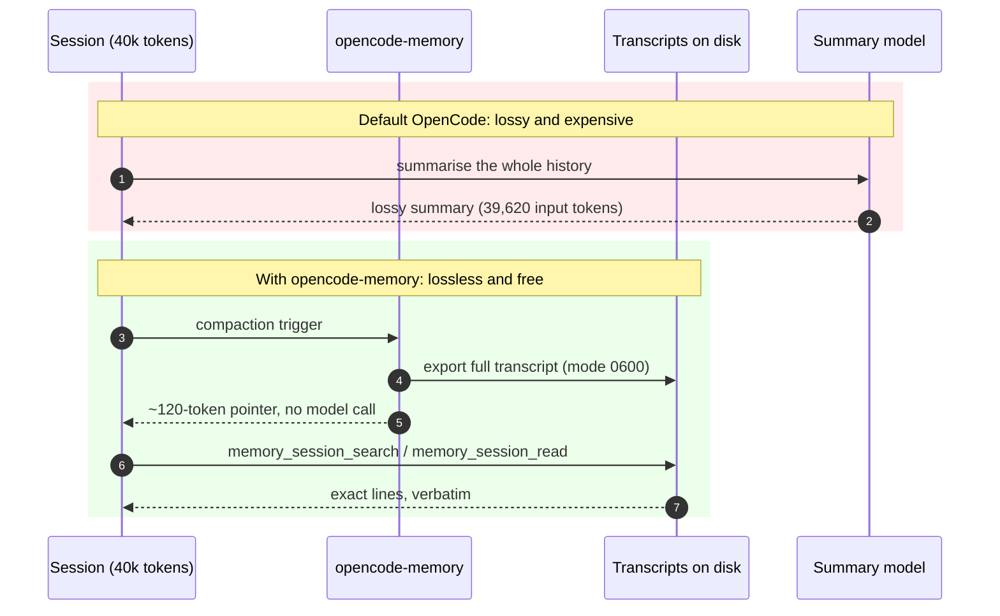
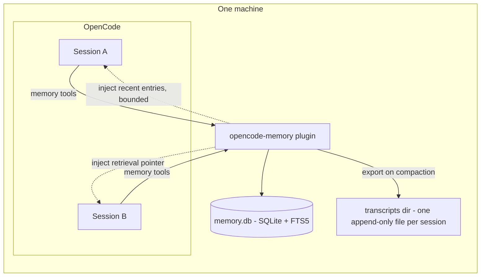

# opencode-memory

[](https://github.com/log0u7/opencode-memory/actions/workflows/ci.yml)
[](LICENSE)
[](https://www.typescriptlang.org)
[](https://www.npmjs.com/package/@log0u7/opencode-memory)
[](https://www.npmjs.com/package/@log0u7/opencode-memory)

Working memory for [OpenCode](https://opencode.ai): a shared SQLite store that all sessions on a machine read and write, so decisions, facts, and lessons survive session boundaries. And when compaction hits, the full transcript is exported and a ~120-token pointer replaces the lossy summary: exact recall, zero model tokens.

Every session gets the memory tools (`memory_save`, `memory_search`, `memory_list`, `memory_get`, `memory_forget`, `memory_stats`, `memory_restore`, `memory_sweep`, `memory_endorse`, `memory_export`, `memory_import`) plus transcript search, reading and cleanup when context retrieval is enabled. Entries are scoped per project worktree (plus a `global` scope), searched with SQLite FTS5 (BM25 ranking, entries matching every query token first, then prefix matches fill the remaining slots). Entries also carry a per-project scope: the injected block only carries global entries plus the session project's entries, so one project's lessons stay out of every other project's prompt (rows written before 0.23.0 have no project and inject everywhere). Recent entries are also injected into the prompt: computed once per session and repeated byte-identical on every request, so the prompt cache holds, and again during compaction. 100% local, no cloud, no API keys.

## Why

Two problems every long OpenCode session hits:

1. **Sessions forget.** A decision made on Monday ("use WAL mode") is gone by Wednesday's fresh session, and the agent never thinks to grep old notes.
2. **Compaction destroys context.** When the context window overflows, OpenCode asks a model to summarise the whole history in one call - measured on a live ~40k-token session: 39,620 input tokens, tens of seconds - and the result is lossy by construction: exact errors, paths and numbers get paraphrased away.

opencode-memory fixes both with one idea: keep the full record, let the agent retrieve what it needs.



## Highlights

- **Lossless compaction.** The summary model call is replaced by a pointer: the transcript path, the last user request, and the retrieval rule. Zero model tokens, nothing paraphrased away, no dependency on a prompt cache.
- **Memory that outlives sessions.** One SQLite store (WAL mode, FTS5 BM25 ranking) shared by every session on the machine, scoped per project worktree plus a `global` scope. Recent entries are injected into the prompt automatically.
- **The agent writes its own memory.** The system prompt nudges it to save durable decisions, facts, preferences and gotchas as they emerge; distilled lessons (`kind=lesson`) are injected first in later sessions, so known mistakes are not retried.
- **Lessons that heat up.** A lesson re-recorded (same angle revisited) gains heat; hot lessons (heat >= 2) are injected FIRST and exempt from the injection budget, so a recurring mistake is seen before it repeats. Lesson lines are never truncated or compressed. Anchored lessons self-stale when the code moves and cool down at sweep once the discipline lives in the code.
- **Exact recall from past sessions.** `memory_session_search` greps exported transcripts for exact lines with context; `memory_session_read` reads a numbered window; `/memory-continue <sessionID>` brings a past session back into the current one.
- **Token economy.** Search results serve 500-char previews with a real-length marker; `memory_get(id)` returns the complete entry on demand: the 20k-token search wall is gone.
- **Self-reflection, inference-only.** The system prompt directs the running model itself to distill its errors into lessons (`memory_save` kind=lesson), no separate model call, no fine-tuning: the model is frozen, the memory learns. Configurable via `reflection: { enabled, ... }` (options in the Feedback loop section below); no daily cap: bursts are legitimate (fresh install, new model), and the store's own guards (title dedup + heat, supersede suggestions, sweep) carry the hygiene.
- **Cross-host sync.** Paired [opencode-mesh](https://www.npmjs.com/package/@log0u7/opencode-mesh) hosts exchange endorsed entries automatically: `memory_endorse` (or `shareable: true` at save) marks an entry worth sharing, the housekeeping pass exports it to the mesh outbox, the mesh pushes it TLS-pinned every 15 min, and the peer imports it into its `global` scope. One agent's lesson becomes the fleet's lesson.
- **Safe by default.** Secret-shaped strings are refused at write time; deletes go to a restorable trash; query deletes never cross scopes; tool results are size-capped; everything stays on the machine - no cloud, no API keys.

## Safety limits

- Results are capped: at most 50 entries per call, and each body is rendered as a 500-character preview. A tool result has a bounded size whatever the model asks for.
- `memory_save` rewrites an entry that repeats a scope and title instead of stacking duplicates, and purges expired rows.
- `memory_forget` by query only deletes inside the caller's scope (plus the shared `global` scope); by id it trashes the entry wherever it lives, since ids are globally unique. Either way it reports the titles and ids it removed, so a broad query delete is auditable.
- Entries that look like secrets (`sk-…`, `github_pat_…`, `gho_…`, `glpat-…`, `xoxb-…`, webhook URLs, …) are refused, in the title, kind, body and tags alike.

## Install

Register the plugin in `opencode.json` (project or global `~/.config/opencode/opencode.json`):

```json
{
  "plugin": ["@log0u7/opencode-memory"]
}
```

Restart OpenCode. That is it: the store lives at `~/.local/share/opencode-memory/memory.db` (honors `XDG_DATA_HOME`).

The package is installed automatically at startup into opencode's plugin cache (`~/.cache/opencode/packages/`); no global npm/pnpm/mise install is needed (opencode does not consult global installs for plugins). Pin a version if you want upgrades to be explicit:

```json
{
  "plugin": ["@log0u7/opencode-memory@0.8.1"]
}
```

Note (npm 12): the package ships no lifecycle install scripts and needs no `allowScripts` / allowlist on install.

## Usage

Nothing to do manually: the model is instructed to search memory at task start and save durable facts as they emerge. You can drive it explicitly:

```
memory_save(kind="decision", title="Use WAL mode", body="...", tags=["db"])
memory_search("postgres migration strategy")
memory_list()
memory_forget(id="...")
memory_stats()
```

### Tools

| Tool | Args | Description |
|---|---|---|
| `memory_save` | `kind`, `title`, `body`, `scope?`, `tags?`, `expires_at?` | Save an entry. The entry carries the session's project; `scope` overrides it (`global` = injected in every project). |
| `memory_search` | `query`, `scope?`, `limit?` | FTS5 BM25 search; entries matching every query token first, then prefix matches fill the remaining slots. Searches cross project scopes by default; `scope` limits hits to one project. Bodies are previews capped at 500 chars (word-boundary cut, `truncated` field carries the real length). |
| `memory_list` | `scope?`, `limit?` | Recent entries, newest first (same 500-char body previews). |
| `memory_get` | `id` | Full entry by id: the complete body plus `paths`, `commit_sha`, `heat`. |
| `memory_forget` | `id` or `query` | Trash one entry by id, or all matching a query. |
| `memory_stats` | `scope?` | Count entries by kind (plus global) with a total, plus the store size and oldest entry. |
| `memory_restore` | `id` | Put a trashed entry back, wherever it lived. |
| `memory_sweep` | `scope?`, `ttl_days?` | Run the full housekeeping pass now: tombstone dated stale entries (recoverable 30 days), delete exact duplicates keeping the newest copy, and run the mesh sync (inbox import + shareable export to the outbox) - the same sequence as the automatic pass. |
| `memory_session_search` | `query`, `sessionID?`, `contextLines?`, `maxBytes?` | Search exported session transcripts for exact lines (case-insensitive), with line numbers and surrounding context. |
| `memory_session_read` | `sessionID`, `offset?`, `limit?`, `maxBytes?` | Read a numbered window of one exported transcript by 1-based line. |
| `memory_transcript_list` | `all?`, `scope?` | List exported transcripts with size, age and last touch (storage visibility). |
| `memory_transcript_cleanup` | `dryRun?`, `apply?`, `allScopes?`, `sessionIDs?`, `retentionDays?`, `keepRecent?`, `maxSessions?` | Sweep transcripts per retention policy; dry run by default. |

### TUI

The plugin ships a TUI part (auto-loaded by OpenCode): a toast on load, a `/memory` slash command, and a status slot in the home footer. Slash commands and the memory tools remain the primary interface.

Entry `kind` is free-form; conventions that work well: `decision`, `fact`, `preference`, `gotcha`, `lesson`, `compaction`.

### Housekeeping

The store is swept automatically so it stays readable: once at plugin boot and then every 24 hours, the project scope (plus `global`) gets a conservative pass. `memory_sweep(scope?, ttl_days?)` runs the exact same pass on demand: sweep, plus the mesh sync twins (inbox import, shareable export to the outbox), so a manual sweep never leaves the outbox waiting for the next daily tick.

- **Dated entries**: an entry whose content carries a state marker (ISO dates, `état:`, `état au`, `state as of`, `en cours`, `en vol`, `attente`, `pending`, `ETA`) and has not been updated for 7 days is tombstoned (`deleted_at`), following the standard 30-day trash: `memory_restore` puts it back.
- **Exact duplicates**: two live entries of the same scope with the same normalized title and body, and the same anchoring, collapse to the newest copy; the older ones are deleted for good (an exact duplicate adds nothing to the trash).

Exemptions keep the sweep conservative: `lesson` entries are never dated-swept (an anchored lesson's freshness is the anchoring's job, decided at read time), `epic`/`task` entries (orchestrator steering) are exempt from both rules, and anchored entries (paths + commit) are left to the anchoring — the inventory already stops asserting them when their code moved.

Options:

- `housekeeping` (default `true`): set `false` to disable the automatic boot/daily sweep (`memory_sweep` stays available).
- `sweepTtlDays` (default `7`): the age threshold of the dated rule.

### How it fits together



One SQLite store (WAL mode, concurrent-safe) holds the entries; the transcripts directory holds the full session records, one append-only file per session. Entries are scoped per project worktree plus a shared `global` scope; all sessions on the machine share the store, and nothing leaves the machine.

### Feedback loop

The agent is nudged to write memory itself: the system prompt asks for durable decisions, facts, preferences and gotchas as they emerge, and the compaction prompt repeats the instruction next to the store inventory. Reusable lessons (`kind=lesson`: a non-obvious approach that clearly failed or succeeded, and why) are injected first in later sessions, so known mistakes are not retried.

Reflection is a standing directive by default (inference-only): the system prompt directs the running model to distill its lessons itself when corrected or when an approach fails (`memory_save(kind=lesson, paths=[...])`), no separate model call. It is on by default; `reflection: false` (or an object config without `enabled: true`) switches it off.

There is no per-day cap on lesson saves: a burst (fresh install, new model) legitimately produces many lessons at once, and the anti-spam work is the quality bar in the directive, the replace-by-title dedup (with heat), the supersede suggestion at save, and the sweep.

The optional LLM reflection (opt-in legacy) distills lessons with one bounded call instead: with `{ "reflection": { "enabled": true } }`, on `session.idle` the plugin sends the last `transcriptChars` of the session to one LLM call and saves the distilled lessons through the same store (the secret guard applies). Subagent sessions are skipped and at most one reflection runs per session.

```json
{
  "plugin": [
    ["@log0u7/opencode-memory", { "reflection": { "enabled": true } }]
  ]
}
```

Options (LLM reflection): `enabled`, `model` (`"provider/model"`, default: the host's model), `transcriptChars` (default 8000), `timeoutMs` (default 60000). Cost per run: ~2k input tokens (the bounded transcript) and at most ~300 output tokens, at most once per session: roughly $0.001 with a small model, $0.01 with a frontier model (indicative). The directive and the injections are plain text: they cost nothing. All plugin options: see [docs/CONFIGURATION.md](docs/CONFIGURATION.md).

### Context retrieval

Compaction normally asks a model to summarise the session: one expensive call over the whole history (measured on a live ~40k-token session with GLM-5.3-Flash: 39,620 input tokens, $0.0018, tens of seconds), and the summary is lossy. With context retrieval the plugin replaces that summary with a pointer and keeps the record:

The approach follows Mainplane's context retrieval (https://github.com/mainplane-ai/mainplane, MIT): keep the full record, let the agent retrieve what it needs instead of summarising.

1. When a compaction runs (automatic, on context overflow, or manual), the plugin exports the exact transcript being summarized to `~/.local/share/opencode-memory/transcripts/<scope>/<sessionID>.md` before anything is discarded.
2. The compaction result becomes a short pointer (~120 tokens): the transcript path, the last user request, and the working rule to retrieve details with `memory_session_search` / `memory_session_read` instead of guessing. The summary model call is skipped entirely: measured live, the compaction completes with no model cost.
3. Later, the agent searches the transcript and copies the exact lines it needs, when it needs them: nothing is paraphrased, and the result does not depend on a prompt cache.

The compaction prompt still asks for durable knowledge to be saved with `memory_save`; that instruction moves into the pointer text so it survives the skipped call.

Options (under the plugin options object):

```json
["@log0u7/opencode-memory", { "retrieval": { "enabled": true } }]
```

- `enabled` (default `true`): `false` restores the plain summary flow and hides the two retrieval tools.
- `dir` (default `~/.local/share/opencode-memory/transcripts`): where transcripts are exported.
- `inlineOutputMaxBytes` (default 50000): tool output above this size is truncated head+tail in the transcript, with the tool call id kept in the marker so the full output stays recoverable from OpenCode's tool-output store.
- `retentionDays` (default 0, disabled): transcripts whose last touch is older than this many days become eligible for removal. 0 keeps everything (recommended default).
- `keepRecent` (default 10): safety floor, never remove the N newest transcripts of a scope even if they are old.
- `maxSessions` (default 0, unlimited): hard cap on transcripts per scope (newest kept).
- `autoSweep` (default true): when `retentionDays` or `maxSessions` is set, run a sweep 30s after startup and after each compaction. Set false to keep manual control only.

This feature is V2-only (it hooks the V2 compaction request). The transcript holds the full session history, which can include secrets typed or read during the session: the directory is created `0700` and files `0600` regardless of umask, and the store never leaves the machine.

If the export fails (disk full or permission error), compaction falls back to the model-written summary silently. The failure is environmental, not a logic bug: check disk space and write access on the transcripts directory.

`memory_session_search` accepts `all: true` to search every project's transcripts on the machine, not just the current scope's. A session whose transcript is not on disk yet is exported on demand (from the host's session store) the first time a tool names it: old sessions work without pre-exporting everything.

The `/memory-continue <sessionID>` command brings a past session into the current one: it exports the transcript if needed and injects the retrieval pointer (path, last request, working rule) as a prompt.

The `/memory-cleanup` command runs the retention sweep (dry run by default; pass `apply` to delete) and reports eligible files. Auto-sweep, when enabled, runs 30s after startup and after each compaction.

Measured on a live ~40k-token session with GLM-5.3-Flash (openrouter): the model-written summary cost 39,620 input tokens and $0.0018; the retrieval pointer compaction completed with no model call at all. The agent then recovered an exact value planted in the compacted session from a fresh session via `memory_session_search`. Live measurement on the local 30k-context model was not possible: a fresh session already overflows its window before any history exists, so compaction cannot run on it (model limitation, unrelated to this feature).

### Design decisions

- **Why a file, not SQLite.** The session record already lives in OpenCode's own SQLite database; the plugin must not duplicate it there, and OpenCode's DB is internal (no stable external schema). What the agent needs is not storage but a greppable projection: line-numbered plain text that `memory_session_search` and `memory_session_read` address with `path:line`, one append-only file per session (no write contention), readable with `less`/`diff` by humans. The plugin's own SQLite keeps only a lightweight index (one row per transcript); a second full-text copy of every transcript body in the store would add megabytes per session for a search grep already answers in milliseconds at this scale.
- **Why skip the summary model call.** The summary is the most expensive call of a session (full re-tokenization at once) and the lossiest step (exact errors, paths, numbers get paraphrased away). The pointer replaces it with a fixed ~120-token text: cheaper, cache-independent, lossless.
- **Provider state trade-off.** A synthetic compaction result does not carry provider cache state, so the next request re-prefills a small prefix. Accepted: it is the same trade the retrieval approach makes everywhere, and the post-compaction context is small anyway.
- **Why the pointer injects in place.** A server-side plugin command cannot switch the TUI to another session, so `/memory-continue` brings the old session's pointer into the current session instead of spawning a new one. `/fork` first if a separate session is wanted.

### Notes

- All sessions on the machine share one store (WAL mode, concurrent-safe).
- Entries that look like secrets (`sk-…`, `github_pat_…`, `gho_…`, `glpat-…`, `xoxb-…`, webhook URLs, …) are refused, in the title, kind, body and tags.
- Every repeated `memory_save` of the same title in the same scope rewrites the entry, so the store does not grow with duplicates, and expired rows are purged on save.
- `memory_forget` never destroys anything: both forms move entries to a trash that `memory_restore` brings back by id, and a sweep drops trash older than 30 days. Query deletes still never leave the scope they are called from, so a project cannot fuzzily delete another project's entries, and by id they trash anywhere (ids are globally unique), which keeps closed worktrees cleanable. Both forms report the titles and ids they removed.
- `memory_save` reports whether it created an entry or rewrote the one already holding that scope and title, so a silent overwrite is visible to the model.
- `memory_stats` reports the store size on disk and the oldest live entry next to the kind counts. The store has no size cap and no eviction, so this is the only growth signal.
- Every entry records the agent that wrote it (`source` carries the mechanism: the legacy LLM-distilled lessons carry `reflection`, directive-saved lessons carry the saving agent), and the session inventory names the writer, so knowledge from a sibling session or from reflection is distinguishable from what this session wrote.
- On the first request of a session, the most recent entries are computed into a bounded list and injected into the system prompt; every later request of that session (each tool-loop step included) carries the same block byte for byte. OpenCode rebuilds the system prompt on every call, so a block injected only once would vanish from step 2 on and the changed prefix would defeat the provider's prompt cache (llama.cpp's slot cache too). The list is not rebuilt mid-session, not even when a lesson is saved: new entries reach live sessions through `memory_search`, and new sessions through their own inventory.
- The injected block carries each non-lesson entry's body next to its title, compressed when the body runs long (first sentence, plus a pointer to `memory_search`; the store keeps the full text either way). Lesson lines stay verbatim, title-only, and are never truncated. The budgeted half of the block is hard-capped and the coldest entries fall off first; hot lines ride outside that cap.
- When [caveman](https://github.com/JuliusBrussee/caveman) (or one of its OpenCode ports) is installed, the guidance switches to a terse variant and asks for terse entries, since every stored title and body is re-read on each recall. Without caveman nothing mentions it. Detection and override: see [docs/CONFIGURATION.md](docs/CONFIGURATION.md#caveman).
- On session compaction, the plugin lists the stored entries in the compaction context and asks the compaction prompt to emit durable decisions, so the model summarises from an inventory instead of recall. With context retrieval enabled (default), the summary call is replaced entirely: see "Context retrieval" above.
- Injections stay bounded (4000 characters of budgeted lines worst case; hot lines ride on top) and nothing is injected, nor any store file created, when memory is unused.

## TUI panel

The plugin renders a `Memory` panel in OpenCode's sidebar. Click the title to collapse or expand it. Expanded:

```text
▼ Memory
  ● 2 hot · sweep 3h ago
  ▤  142 live · 7 trashed
  ≡  84 facts · 31 lessons
  ≡  12 decisions · 8 gotchas
  ≡  5 preferences · 2 tasks
  ⌗  3.0 MB
  ⇄  sync in 2 · out 1
```

| Line | Meaning |
|---|---|
| `▼ Memory` | The panel title, clickable: toggles the collapsed/expanded state. |
| `● N hot` | Hot lessons (`heat >= 2`): recidivism, injected in priority. Line omitted at 0. |
| `sweep N ago` | Age of the last housekeeping pass (shown on the hot line, hidden with it). |
| `▤ N live · N trashed` | The store: current entries vs tombstoned ones (recoverable for 30 days). |
| `≡ N facts · N lessons` | Breakdown by kind, two per line, biggest first; extra kinds continue on the next lines. |
| `⌗ N MB` | The store file size on disk: `N MB` from 1 MiB up (one decimal), `N kB` below. Line omitted when the store reads 0. |
| `⇄ sync in N · out N` | Cross-host sync: `in` = inbox files to import, `out` = shareables to push to peers. Line omitted without opencode-mesh. |

Collapsed, the panel reduces to one quota-style line (the hot count disappears at 0):

```text
▶ Memory · 142 Records · 3.0 MB · ● 2 hot
```

### Status reference

Every state and marker the panel can show, checked against `formatMemorySidebarExpanded` / `formatMemorySidebarCollapsed` in [src/rpc.ts](src/rpc.ts):

| Marker / state | Meaning |
|---|---|
| `● N hot` | Hot lessons (`heat >= 2`: the same lesson recorded again = one recurrence), injected in priority; cooling steps `heat - 1` per sweep while the anchoring stays fresh. Omitted at 0. |
| collapsed `▶ Memory · N Records · N MB · ● N hot` | The store state plus the hot marker (omitted at 0); the size reads `N kB` below 1 MiB. The `▶` mirrors the expanded `▼` and the whole line is clickable. Numbers render in the qualifier tone, labels and separators in value. |
| `▤ N live · N trashed` | The store: current entries vs tombstoned ones (recoverable for 30 days via `memory_restore`). |
| `≡ N facts · N lessons · …` | The breakdown by kind (two per line, biggest first). |
| `⌗ N MB` | The SQLite store size on disk (`N MB` from 1 MiB up, `N kB` below); line omitted at 0. |
| `⇄ sync in N · out N` | Cross-host sync: `in` = inbox files to import, `out` = shareables to push (line omitted without opencode-mesh). |
| `sweep N ago` (on the hot line) | Age of the last housekeeping pass. |
| `Memory (no store)` | The store does not exist yet. |
| footer `N Records · N MB` (`1 Record · N kB`) | The legacy footer line: the same store, compact (count for the calling scope plus `global`) with the store size; numbers in qualifier, labels in value. |

The kind breakdown also lives in `memory_stats`.

## Development

Requires Node >= 22 (mise: `mise install`) and pnpm (corepack).

```sh
pnpm install
pnpm verify      # biome + typecheck + vitest
pnpm build:check # tsc build + pack dry-run
```

See [CONTRIBUTING.md](CONTRIBUTING.md) for the workflow.

## License

[Apache-2.0](LICENSE)
